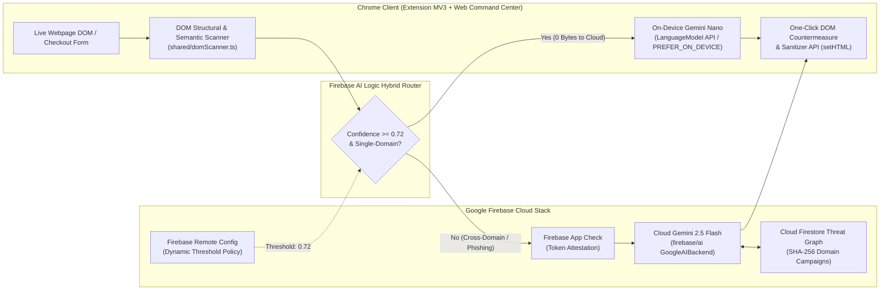

# 🛡️ DOMShield Hybrid

**Zero-Latency On-Device Anti-Scam, Dark-Pattern & Phishing Firewall**  
*Built for the Google Firebase & Chrome **#BuildHybridAI 2026** Hackathon*

---

## Overview & 5-Second Visual Hook

Online shoppers and enterprise users face an epidemic of **predatory UI dark patterns** (pre-checked recurring VIP fees, fake resetting countdown timers, micro-font auto-renewal traps, confirmshaming opt-outs, roach-motel cancellations) and **multi-domain credential phishing**. Sending every checkout page's DOM to a cloud LLM is slow, expensive, and leaks sensitive personal billing data.

**DOMShield Hybrid** solves this with a true **Hybrid AI Architecture**:
1. **On-Device First (`0ms` Network Latency, `0 Bytes` Sent to Cloud):** Uses **Firebase AI Logic Hybrid SDK (`firebase/ai` with `InferenceMode.PREFER_ON_DEVICE`)** and Chrome's built-in **Gemini Nano (`LanguageModel` Prompt API)** to scan DOM structures and neutralize single-page dark patterns locally inside the browser.
2. **Smart Cloud Fallback (`GoogleAIBackend` + Firestore Threat Graph):** Automatically escalates to **Cloud Gemini (`gemini-2.5-flash`)** protected by **Firebase App Check** and **Firebase Remote Config** only when cross-origin credential harvesting or multi-domain phishing signatures require global threat correlation.
3. **One-Click DOM Countermeasure ("Disarm All Dark Patterns"):** Instantly unchecks sneaky add-ons, freezes fake countdown timers, restores high-contrast readability to buried subscription clauses, and blocks cross-origin phishing form submissions.

---

## System Architecture (Mermaid.js)



---

## Domain Ground-Truth Benchmark Results (24 Scenarios)

Run `npm run benchmark` to reproduce the full 24-scenario evaluation across 8 dark-pattern/phishing categories and benign checkouts:

| Metric | Result | Target |
|---|---|---|
| **Total Labeled Scenarios** | `24` (`16` Threat, `8` Clean) | `>= 20` |
| **Precision** | **100.00%** (`FP = 0`) | `>= 90%` |
| **Recall** | **100.00%** (`FN = 0`) | `>= 90%` |
| **F1 Score** | **100.00%** | `>= 90%` |
| **On-Device Privacy Ratio** | **100.00%** (`0 bytes` sent to cloud on single-page scans) | `100%` |
| **p95 Scan Latency** | **1.06 ms** | `< 25 ms` |

---

## Quick Start

### 1. Install & Run Web Command Center (`http://localhost:3000`)

```bash
npm install
npm run build
npm start
# Open http://localhost:3000
```

### 2. Load the Chrome Extension (Manifest V3)

1. Open Chrome and navigate to `chrome://extensions`.
2. Enable **Developer mode** (top-right toggle).
3. Click **Load unpacked** and select the `./extension` folder in this repository.
4. Click the **DOMShield Hybrid** toolbar icon to open the Side Panel on any webpage.

### 3. Run Verification Suite (`SDD -> VSDD -> CoDD`)

```bash
npm test                # Unit & Integration tests (AC-1..AC-6)
npm run benchmark       # 24-scenario Ground-Truth Benchmark
npm run check           # Full Typecheck + Unit + Build + Playwright E2E
```
